Page background: 

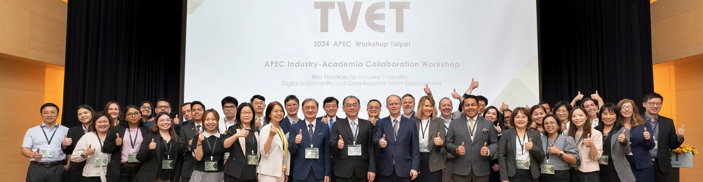

# APEC Events

## 2025 APEC Youth Engagement Workshop: Connectivity, Partnership, and Opportunities

July 3-4, 2025

This project aims to empower regional youth by enhancing their communication skills, fostering cross-border collaboration, and deepening their understanding of global issues. Through a two-day interactive training program, participants will engage with experts and stakeholders from APEC-related fields to explore how communication and language skills are essential in navigating cross-regional platforms and international collaboration settings.

## APEC Forum on Women and Youth Empowerment: Advancing Innovative Education and Enhancing Workforce Skills for a Sustainable and Inclusive Future

November 13-15,2024 (APEC Sub-fund: Women and Economy)

Co-sponsoring economies: Chile; Indonesia; Japan; Korea; Malaysia; New Zealand; Peru; Singapore; Thailand

To promote inter-regional educational cooperation and strengthen economic development, the Ministry of Education is holding the “2024 APEC Women and Youth Empowerment Forum: Promoting Innovative Education and Enhancing Labor Skills for a Sustainable and Inclusive Future,” which officially commences today (November 13th). Approximately 80 participants, including youth from 16 APEC economies and students from our country, have gathered in Taipei for three days of exchange activities. The forum focuses on innovative education, empowering youth and women, and collaboratively promoting sustainable development and inclusive economic growth in the APEC region.

## Best Practices for Inclusive Innovation, Digital Sustainability and Cross-regional Talent Development

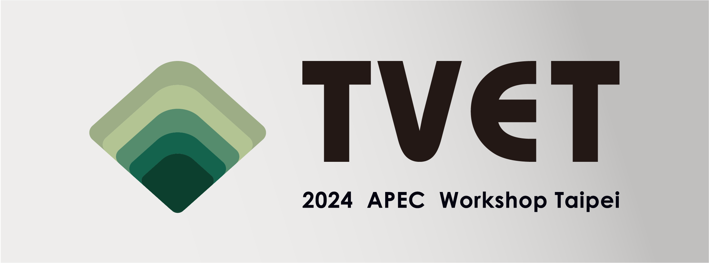

August 28-29,2024 (APEC Sub-fund: Digital Innovation)

Co-sponsoring economies: Chile; Indonesia; Korea; Malaysia; Peru; Thailand; USA

This year's workshop continues the tradition of fostering collaboration and innovation among 13 APEC economies. Participants, including government officials and educators, will engage in discussions and share best practices that promote inclusive innovation, digital sustainability, and cross-regional talent development. The workshop will also include site visits to educational institutions and enterprises, providing participants with firsthand insights into successful models of collaboration.

## 2024 APEC Youth Capacity Building Training & Model APEC

July 4-5, 2024

This program gathered policymakers, government officials and experts who work in APEC related sectors to share with the regional youth regarding how APEC operates. A Model APEC conference was also organized for the young participants to learn more about how issues are discussed in a regional economic forum, and how to present and voice their opinions in an official setting.

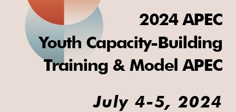

## APEC Youth Impact Forum: Promoting Local Sustainability and Inclusive Growth to Enhance Post-pandemic Regional Resilience and Prosperity

October 25-27, 2023 (APEC Sub-fund: Women and Economy)

Co-sponsoring economies: Indonesia; Japan; Korea; Malaysia; Philippines; Thailand; Thailand; United States

To promote cross-regional education cooperation and strengthen post-pandemic economic recovery, more than 70 young people are invited from 16 APEC member economies to participate in this important three-day event. The Forum focuses on local revitalization and inclusive development, enhancing regional economic resilience in the post-pandemic era. It aims to showcase best practices of policies and educational initiatives for regional revitalization and sustainable entrepreneurship and discuss how to predict the future development of the regional economy by fostering local industries.

## Digital and Inclusive Talents Cultivation and Technology (AI)-Enabled Collaboration: TVET's Integrative Models of Skills and Trainings

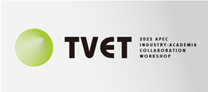

August 31 - September 1, 2023 (APEC Sub-fund: Digital Innovation)

Co-sponsoring economies: Chile; Indonesia; Japan; Korea; Malaysia; Thailand

The workshop aimed to demonstrate how to narrow the skills gap and cultivate digital and AI talents through technological vocational education, providing an in-depth introduction to the collaborative model between the academia sector and industry sector.

## 2023 APEC Youth Capacity Building Training & Model APEC

July 6-7, 2023 (self-funded)

This program gathered policymakers, government officials and experts who work in APEC related sectors to share with the regional youth regarding how APEC operates. A Model APEC conference was also organized for the young participants to learn more about how issues are discussed in a regional economic forum, and how to present and voice their opinions in an official setting.

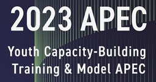

## APEC Forum on Entrepreneurship for the Future of Work: Accelerating Regional Economic Recovery and Digital Inclusion for Women and Youth in the Post Pandemic Era

November 16-18, 2022 (APEC Sub-fund: Women and Economy)

Co-sponsoring economies: Indonesia; Japan; Korea; Mexico; Peru; Singapore; Thailand

The APEC Forum on Entrepreneurship for the Future of Work was the first physical event after the pandemic that invited speakers and delegates from the APEC region to participate and to discuss the post-pandemic job market. The forum attracted greater over-seas participation than ever before. 91 delegates from 16 APEC members economies registered and participated in the 3-day event. For more information, please visit the [website](https://taipeiyie.com/en-2022-forum/).

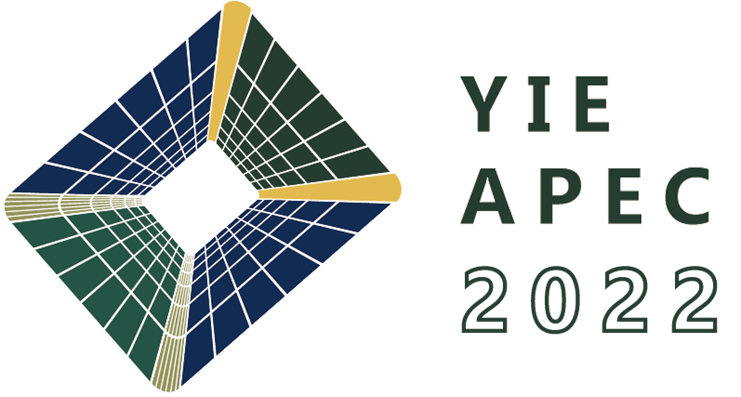

## 2022 APEC Forum on Student Mobility and Innovative Education in the Post Pandemic Era

September 19-20, 2022 (self-funded)

During the past two years, the COVID-19 pandemic has caused significant impact on cross-regional talent cultivation and educational exchange. In order to restore and enhance regional cooperation and to push forward educational and economic growth, this project aims to accelerate innovative education development and human capital cultivation by strengthening the stakeholder partnerships and promoting high-quality education in the digital age. This project also proposes to host a meaningful forum to discuss how to facilitate student mobility and to innovate education in the post pandemic time.

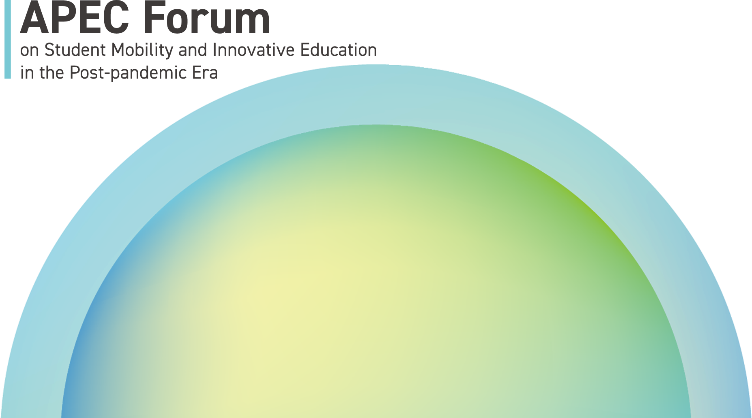

## 2022 APEC TVET Workshop on Success Models of Sustainable and Circular Economy: Green Manufacturing and Intelligent Public Transport

September 12-13, 2022 (self-funded)

Placing sustainable travel and transportation at the heart of post-pandemic economic recovery calls for more integrated actions to strengthen green technology-enabled infrastructure for high efficiency and quality in public transport systems. Smart mobility solutions provide new lenses to the linkage of urban and rural as the integral part of economic recovery and green growth. The primary objective of the project is to create and accelerate an aligned implementation of interdisciplinary collaboration among the government, academia and industry in sustainable transport technology. A two-day workshop will include capacity building, model discussions, ideas exchange from exemplary schools and AI-based organizations and businesses, discovering innovative potentials together with feasibility to apply green technology and AI-enabled transportation solutions and talent training schemes. For more information, please visit the [website](https://www.taipei-tvet.com/2022-hrdwg-ednet-project/).

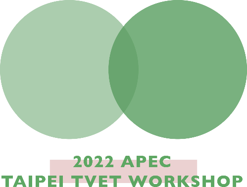

## APEC Digital Economy and Innovative Entrepreneurship Online Forum: Enhancing Inclusive Participation and Digital Upskilling for Youths

March 23-24, 2022 (APEC Sub-fund: Digital Innovation)

This event is a two half-day online forum on digital economy and youth innovative entrepreneurship, held in March 2022 to bring together government officials from related sectors, successful start-up founders, young entrepreneurs, start-up incubation centers or accelerators, and representatives from venture capital companies. For this project, we will also invite past participants from previous projects to share their entrepreneurial journey, the regional resources that they leverage to grow their business, the current market trends, and the most up-to-date and necessary digital skills. For more information, please visit the [website](https://taipeiyie.com/en-2022-online-forum/).

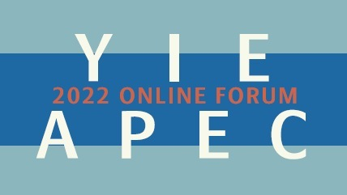

## APEC Forum on Digital Innovation and Entrepreneurship (II): Building Capacity and Collaborative Connectivity for Women and Young Entrepreneurs

July 12-14, 2021 (APEC Sub-fund: Women and Economy)

Co-sponsoring economies: Indonesia; Japan; Korea; Malaysia; Mexico; Singapore; Papua New Guinea

This 3-day forum “APEC Forum on Digital Innovation and Entrepreneurship (II): Building Capacity and Collaborative Connectivity for Women and Young Entrepreneurs” includes a half-day forum covering youth entrepreneurship enhancement and a half-day forum specifically targeted at young female entrepreneurs-to-be, engaging them in a productive dialogue on female empowerment and inclusion in the digital economy. A field visit to successful start-up companies or local innovation centers/incubators will also be included in the program to demonstrate the entrepreneurial environment. For more information, please visit the [website](https://taipeiyie.com/en-2021-forum/).

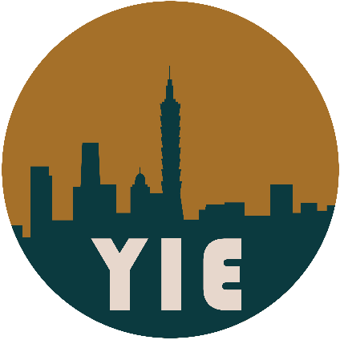

## Regional Industry-Academia Collaboration for Talent Development and Inclusive Growth: Skills Training, Internships, Jobs and Women

May 7, 2021 (APEC Sub-fund: Women and Economy)

Co-sponsoring economies: Indonesia; Malaysia; Mexico; New Zealand; Philippines; Singapore;

Thailand; United States

Under the ongoing talent development scheme, the 2019 project extends the 2018 project for successful implementation of the model to create seamless collaboration between industry and academia. The strategic alliance seeks to provide talent solutions to narrow the skills gap. To strengthen the alliance, it is hoped that APEC economies' delegates not merely attend but effectively acquire the essential components to collaborate in the near future. The key objective of this project is: Strategize seamless network of cross-regional and interdisciplinary collaboration through industry-driven vocational education and training programs that cultivate talents to meet industry demands across economies and to encourage female participation in non-traditional sector. For more information, please visit the [website](https://www.taipei-tvet.com/agenda/).

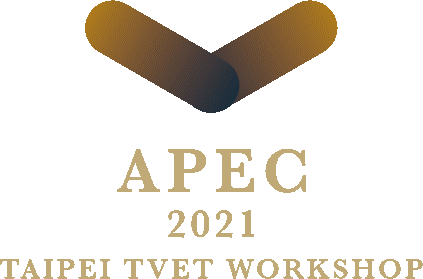

## APEC Forum on Digital Innovation and Entrepreneurship: Building Capacity and Collaborative Connectivity for Young Entrepreneurs

October 7-9, 2019 (self-funded)

Co-sponsoring economies: Republic of Korea; Thailand; Papua New Guinea

The project intends to develop capacity through the transfer and development of knowledge, skills and technical know-how among experienced entrepreneurs and entrepreneurs-to-be from various Asia-Pacific economies. One of the major themes of the workshop is female entrepreneurship, related to inspiring female creativity and improving gender inclusion. Experience sharing during the workshop will further facilitate both internal and regional replicability through dissemination of acquired skills within the participants' home economies and other regional sectors. For more information, please visit the [website](https://www.yietaipei.com/).

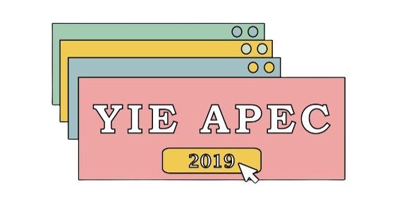

## Regional Industry-Academia Collaboration for Talent Development: An Exchange of Skills Training, Internships, and Jobs (II)

Sep 16-18, 2019 (self-funded)

Co-sponsoring economies: Indonesia; Mexico; Singapore; New Zealand; Thailand; Malaysia; USA; the Philippines

Under the ongoing talent development scheme, the 2019 project extends the 2018 project for successful implementation of the model to create seamless collaboration between industry and academia. The strategic alliance seeks to provide talent solutions to narrow the skills gap. To strengthen the alliance, it is hoped that APEC economies' delegates not merely attend but effectively acquire the essential components to collaborate in the near future. Besides, the 2019 workshop takes on two new tasks to traverse today's workplace landscape in the APEC region, which are to identify the demands and challenges faced by women and how to prepare learners for the technology-enabled/digital economy. Thus, the 2019 project includes forum discussions, workshop demos, and CTE industry tours along with our website, where the latest related information will be posted highlighting women's ability to use the resources available to navigate their careers and digital development as an integral part of economic growth.

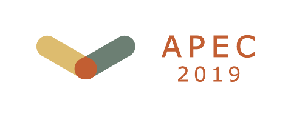

## Asia-Pacific Youth Forum on Digital Innovation and Entrepreneurship: Building Capacity and Collaborative Connectivity for Young Entrepreneurs

October 4-6, 2018 (self-funded)

Co-sponsoring economies: Republic of Korea; Thailand; Papua New Guinea

Entrepreneurial education is a process relying on the transfer of knowledge and ingenuity from successful entrepreneurs to entrepreneurs-to-be, leading to long-term capacity building and innovation initiatives. We are focusing on the most needed and transformative sectors of the digital economy, which offer promise of sustained and sustainable growth and inclusive employment. For more information, please visit the [website](https://www.yietaipei.com/2018/).

## Regional Industry-Academia Collaboration for Talent Development: An Exchange of Skills Training, Internships, and Jobs

June 5-7, 2018 (APEC central-fund)

Co-sponsoring economies: Indonesia; Korea; Philippines; Singapore; Thailand; United States; Viet Nam

To address the issue of youth employability by closing the gap between education and skills, this project re-strategizes collaborative partnerships among APEC member economies. As a follow-up event to the April 2017 TVET (Technological and Vocational Education and Training) Forum hosted in Chinese Taipei, this project highlights a new model of exchange, including professional and technical skills training, internships, talent mobility, and workplace experiences for APEC youth. It will promote and demonstrate a series of strategically-designed, industry-driven TVET programs with partner companies in Chinese Taipei to strengthen connectivity among APEC member economies. A collaborative network built by academic institutions, private sector, and government organizations guarantees long-term exchange of resources and support for multi-lateral enablement.

## Skills Training in Industry-Academia Collaboration in CTE: Best Practices and Implementation in the Engineering, Hospitality and Innovative Entrepreneurship Fields

April 25-27, 2017 (self-funded)

Co-sponsoring economies: Brunei Darussalam; China; Korea; Malaysia; Peru; Philippines; Russia; Singapore; Thailand; Viet Nam

The project, Skills Training in Industry-Academia Collaboration in CTE (Career and Technical Education): Best practices and implementation in the engineering, hospitality and innovative entrepreneurship fields, is a follow-up project to the one completed in 2015, when APEC member economies were invited to come and discuss collaboration models in the fields of engineering, health care, and hospitality and tourism. By 2017, the first couple of Chinese Taipei student cohorts will have already graduated and been employed by partner companies, so delegates from APEC economies may compare the fruits of such collaborations through interaction with the industry and the students themselves. This workshop will be an opportunity for participating economies to discuss the effects of such partnerships and other models in vocational education which can be applied to CTE in each economy.

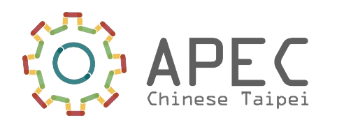

## Industry-Academia Collaboration Models in Technological and Vocational Education and Training: Best Practices in Curriculum Design and Implementation in the Healthcare, Engineering and Hospitality Fields

September 22-24, 2015 (self-funded)

Co-sponsoring economies: Brunei Darussalam; Malaysia; Mexico; Papua New Guinea; Peru; Philippines; Russia; Singapore; Thailand; Viet Nam

This project aims to promote and demonstrate a series of strategically-designed industry-driven TVET programs that through the collaboration and networking between academic institutions, private sector, and government organizations, cultivate an educated and skilled workforce that meets industry needs for APEC economies. This project also promotes human capital development, people-to-people/institutional connectivity, and SME development in the APEC region.

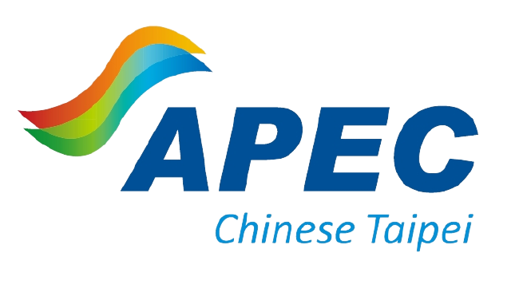

## Sustainable TVET for a Rapidly Changing World Economy: Building an international collaboration network

April 24-25, 2014 (self-funded)

Co-sponsoring economies: Australia; Indonesia; Japan; Malaysia; Russia; United States

This Project aims to share experiences, compare different systems, and provide feasible recommendations with the goal of achieving mutual understanding in policies and systems, which is expected to encourage mobility of skilled workforce across the region and further facilitate trade between member economies. This goal of improving the quality of TVET, as a priority area, will, of course, be achieved through mutual collaboration/cooperation in the form of policy exchange and stakeholders' involvement, as suggested by China and the Philippines.

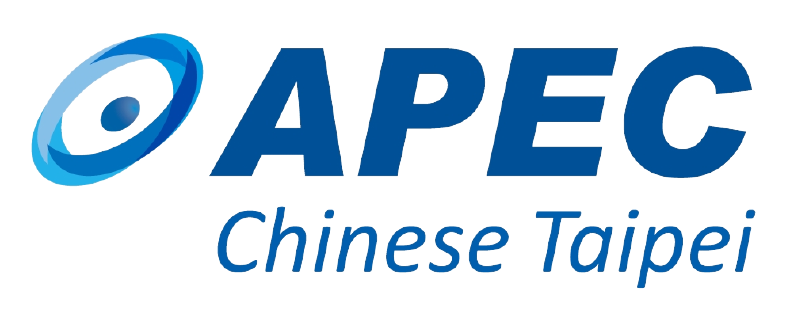
