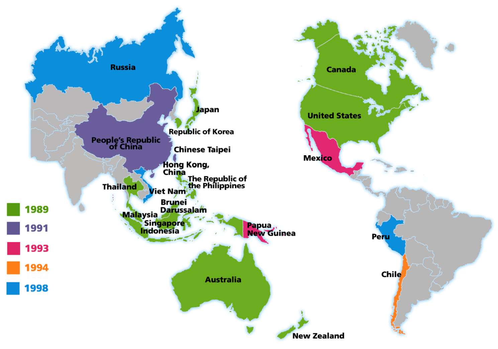
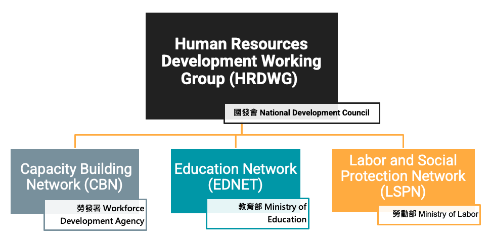
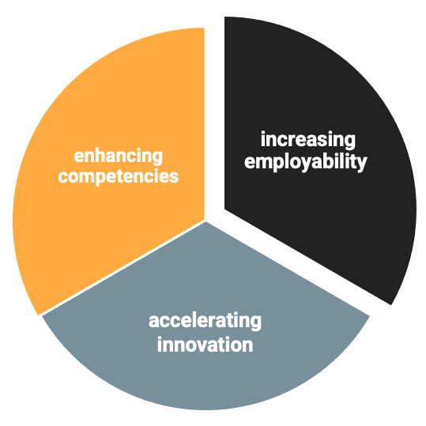

# APEC HRDWG EDNET

APEC Human Resource Development Working Group Education Network

#### APEC Secretariat

APEC seeks to achieve its objectives through a broad work agenda based on three pillars:

- Trade and investment liberalization

- Business facilitation

- Economic and technical cooperation

Established in 1993, the APEC Secretariat is based in Singapore and operates as the central support mechanism for the APEC process. It provides coordination, technical support and consultancy as well as information management, communications and public outreach services.

#### HRDWG

## Human Resources Development Working Group

The objectives of HRDWG are:

- Develop 21st Century Knowledge and Skills for All

- Integrate HRD into the global economy

- Address the Social Dimension of Globalization

HRDWG is composed of three units:

Capacity Building Network (CBN)

Focus on skills development, human resource management and vocational training

Education Network (EDNET)

Focus on fostering strong and vibrant learning systems and promoting quality and equitable education

Labor and Social Protection Network (LSPN)

Focus on fostering strong and flexible labor markets and strengthening social protection, including social safety nets

#### HRDWG in Chinese Taipei

#### EDNET Goals & Objectives

## To foster strong and vibrant learning systems across APEC member economies and strengthen the role of education in promoting social, individual, economic and sustainable development through cross-border education cooperation

- Developing global education cooperation with other relevant fora and institutions, multilateral organizations through collaborative research and publication, exchange programs, training and education

- Providing appropriate opportunities and conducive environment for K-12 children and students in higher education to engage in happy and effective learning

- Preparing today’s youth with appropriate education and training, skills, and participating in cross-border education to succeed in their local education system and compete in a globalized world
