# Newsletter

[button: (no label)](https://www.apeciied.org/_files/ugd/7c0f6d_1b76e61160aa4b3cb43308c8c593a7c9.pdf)

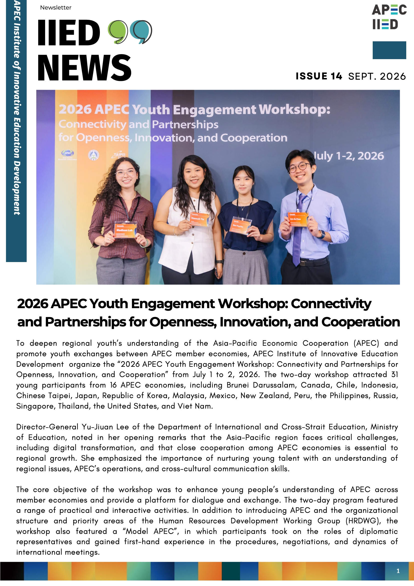

Newsletter 14

- 2026 APEC Youth Engagement Workshop: Connectivity and Partnerships for Openness, Innovation, and Cooperation

[button: Download](https://www.apeciied.org/_files/ugd/7c0f6d_1b76e61160aa4b3cb43308c8c593a7c9.pdf)

[button: (no label)](https://www.apeciied.org/_files/ugd/7c0f6d_ef580918c0c4443ebddced4ae8a6c4cf.pdf)

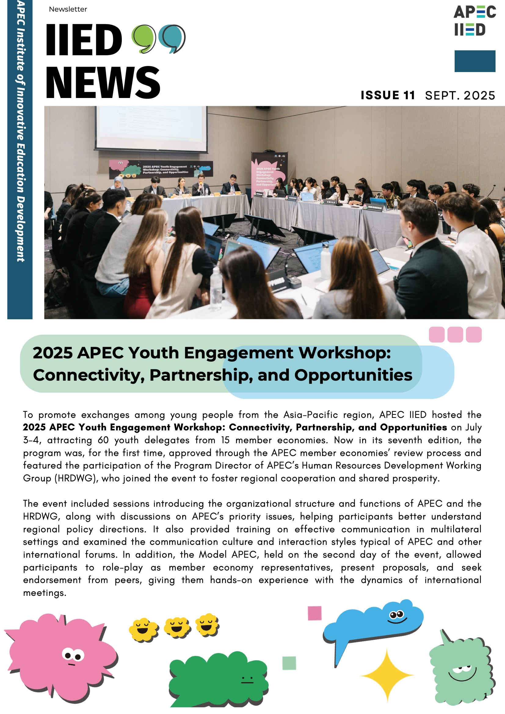

Newsletter 11

- 2025 APEC Youth Engagement Workshop

- 2025 APEC Industry-Academia Cooperation Workshop

- Upcoming Event: APEC Forum on Women and Youth Empowerment

[button: Download](https://www.apeciied.org/_files/ugd/7c0f6d_ef580918c0c4443ebddced4ae8a6c4cf.pdf)

[button: (no label)](https://www.apeciied.org/_files/ugd/7c0f6d_40a5cda7784b4ca1b9c9f931693fb0ae.pdf)

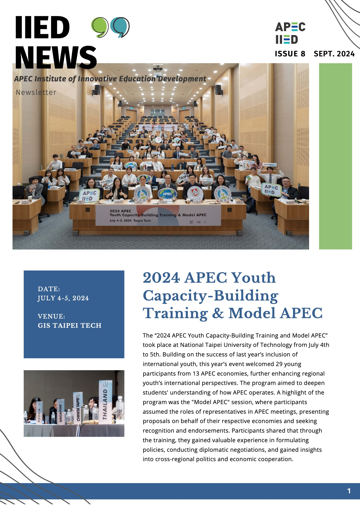

Newsletter 8

- 2024 APEC Youth Capacity-Building Training & Model APEC 

- 2024 APEC Industry-Academia Collaboration Workshop 

- IIED Upcoming Event

[button: Download](https://www.apeciied.org/_files/ugd/7c0f6d_40a5cda7784b4ca1b9c9f931693fb0ae.pdf)

[button: (no label)](https://www.apeciied.org/_files/ugd/7c0f6d_c030e239b2b14b698d8167bbdf70f435.pdf)

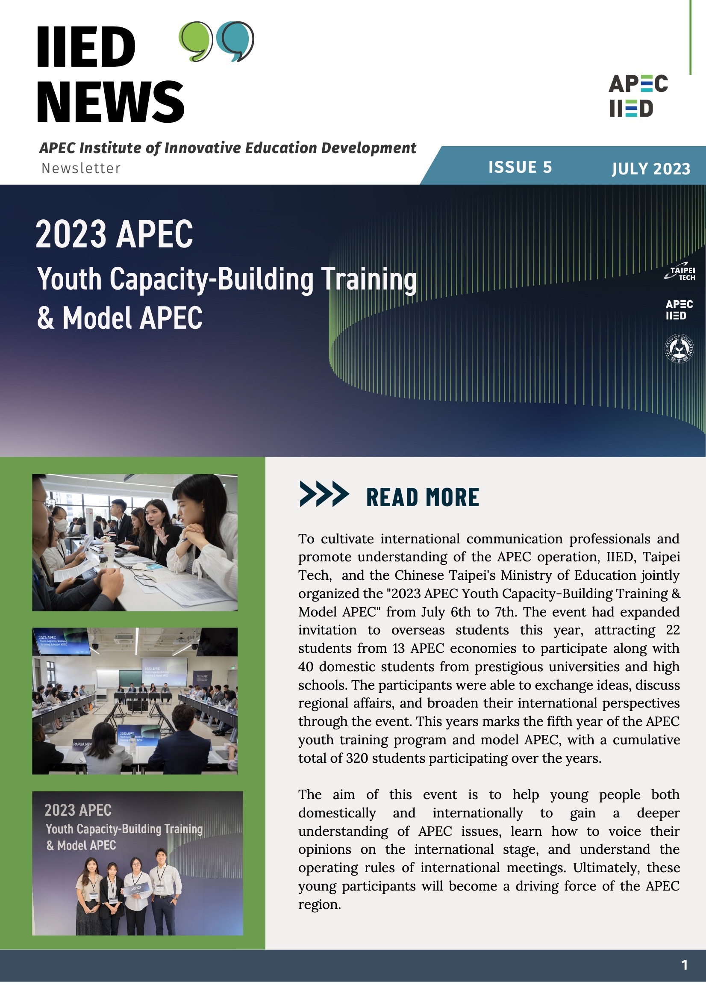

Newsletter 5

2023 APEC Youth Capacity-Building Training & Model APEC 

Upcoming Events: APEC TVET Workshop 

Upcoming Events: APEC Youth Impact Forum

[button: Download](https://www.apeciied.org/_files/ugd/7c0f6d_c030e239b2b14b698d8167bbdf70f435.pdf)

[button: (no label)](https://www.apeciied.org/_files/ugd/7c0f6d_a94e454798104fe0951737050f6a2eb6.pdf)

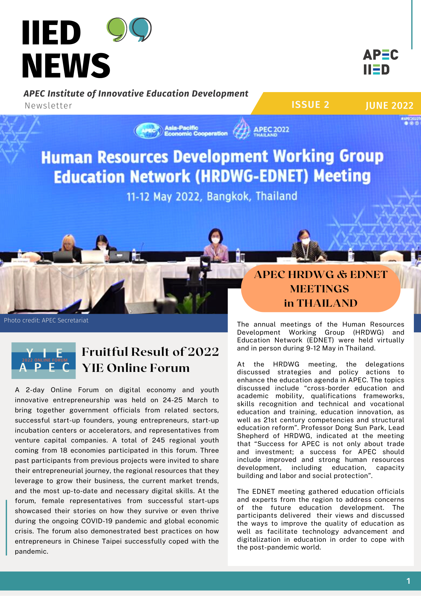

Newsletter 2

- Fruitful Result of 2022 YIE Online Forum

- APEC HRDWG & EDNET Meetings in Thailand

[button: Download](https://www.apeciied.org/_files/ugd/7c0f6d_a94e454798104fe0951737050f6a2eb6.pdf)

[button: (no label)](https://www.apeciied.org/_files/ugd/7c0f6d_44d265bc97c849e992bf8acfdd583687.pdf)

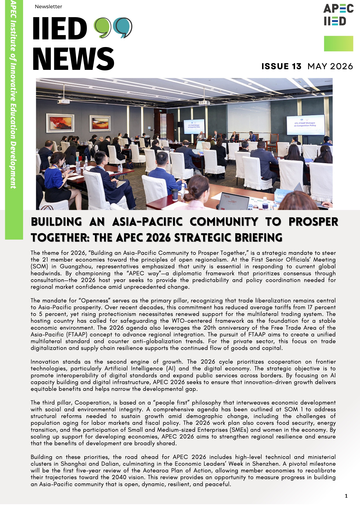

Newsletter 13

- Building An Asia-Pacific Community to Prosper Together: The APEC 2026 Strategic Briefing

- Priorities for APEC: Openness, Innovation, Cooperation

[button: Download](https://www.apeciied.org/_files/ugd/7c0f6d_44d265bc97c849e992bf8acfdd583687.pdf)

[button: (no label)](https://www.apeciied.org/_files/ugd/7c0f6d_d645641fb1ec42df9dd334168daa9424.pdf)

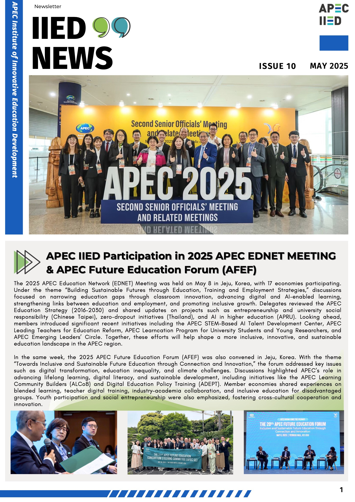

Newsletter 10

- IIED in 2025 APEC EDNET & APEC Future Education Forum (AFEF)

- Priorities for APEC 2025: Connect, Innovate, Prosper

[button: Download](https://www.apeciied.org/_files/ugd/7c0f6d_d645641fb1ec42df9dd334168daa9424.pdf)

[button: (no label)](https://www.apeciied.org/_files/ugd/7c0f6d_774fa3dc7b98416aad0bc1d0166152b7.pdf)

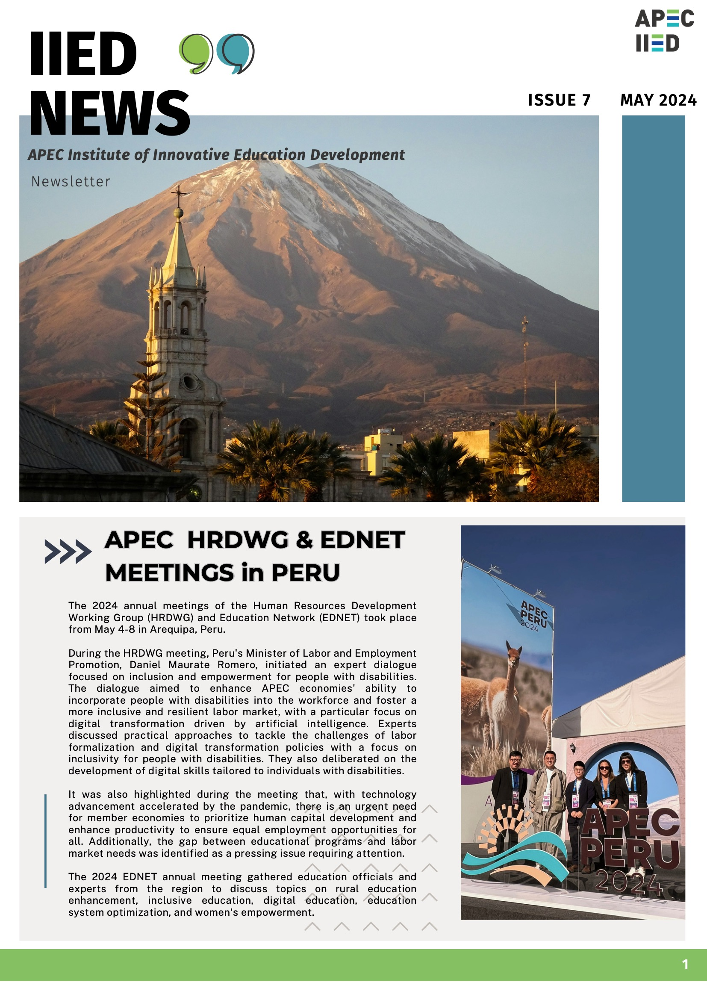

Newsletter 7

- APEC HRDWG & EDNET Meetings in Peru 

- Priorities for APEC 2024 Peru

[button: Download](https://www.apeciied.org/_files/ugd/7c0f6d_774fa3dc7b98416aad0bc1d0166152b7.pdf)

[button: (no label)](https://www.apeciied.org/_files/ugd/7c0f6d_639d38659c834fbdac89dc0f8ad673a8.pdf)

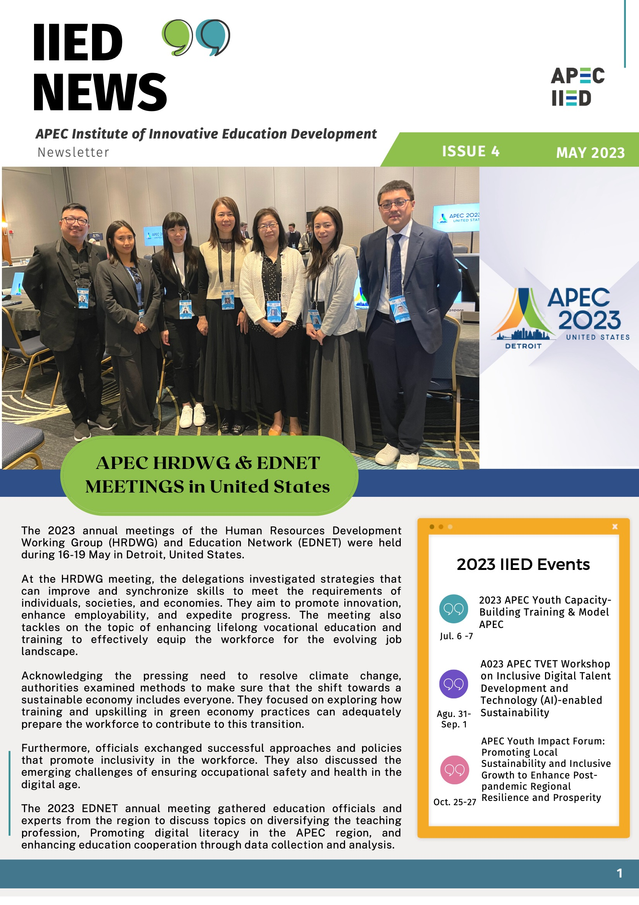

Newsletter 4

APEC HRDWG & EDNET MEETINGS in United States 

Priorities for APEC 2023 United States

[button: Download](https://www.apeciied.org/_files/ugd/7c0f6d_639d38659c834fbdac89dc0f8ad673a8.pdf)

[button: (no label)](https://www.apeciied.org/_files/ugd/7c0f6d_edaa8fd135de47fd97c266216594dfbc.pdf)

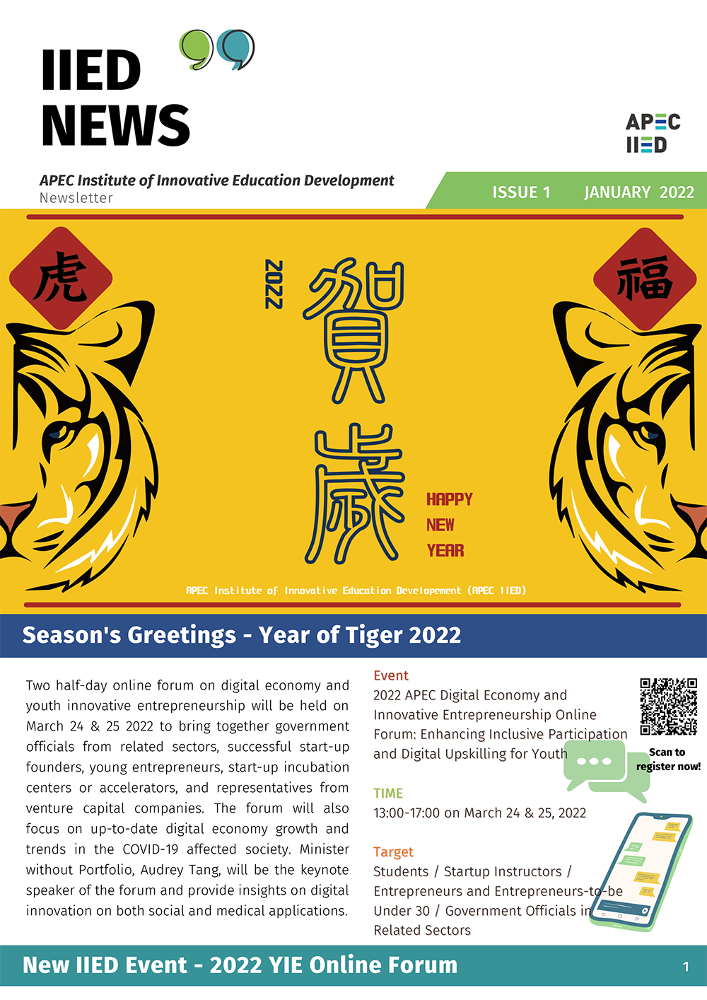

Newsletter 1

- Year of Tiger Season's Greetings 

- Priorities for APEC 2022 Thailand

[button: Download](https://www.apeciied.org/_files/ugd/7c0f6d_edaa8fd135de47fd97c266216594dfbc.pdf)

[button: (no label)](https://www.apeciied.org/_files/ugd/7c0f6d_f594b520e63847fbba96944b79090a91.pdf)

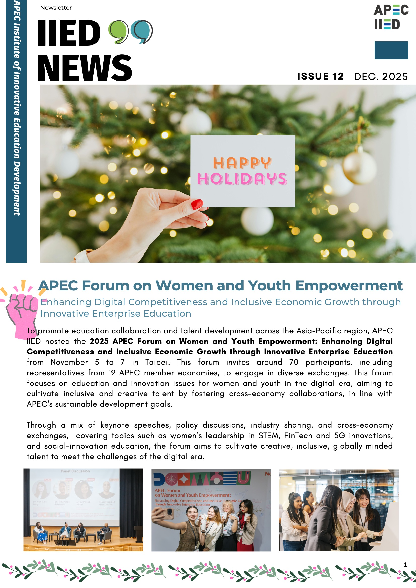

Newsletter 12

- APEC Forum on Women and Youth Empowerment

- 2025 Recap: APEC Youth Engagement Workshop

- 2025 Recap: APEC Industry-Academia Collaboration Workshop

- 2025 Recap: APEC Forum on Women and Youth Empowerment

[button: Download](https://www.apeciied.org/_files/ugd/7c0f6d_f594b520e63847fbba96944b79090a91.pdf)

[button: (no label)](https://www.apeciied.org/_files/ugd/7c0f6d_a2414eb625234bd0b877b1a862377a0b.pdf)

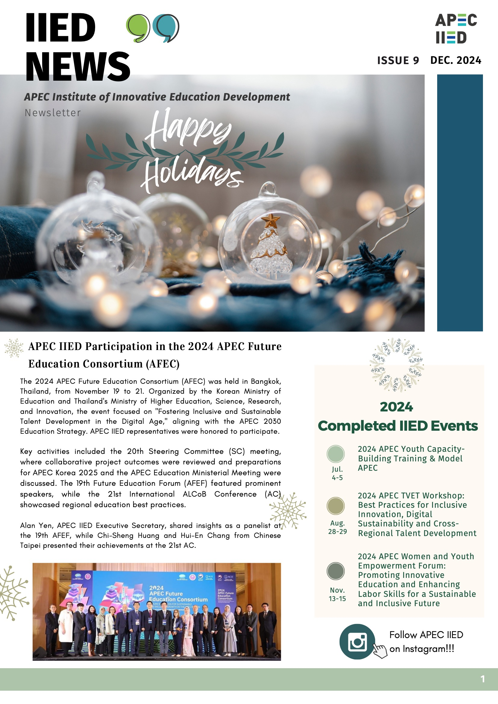

Newsletter 9

- IIED in 2024 APEC Future Education Consortium 

- 2024 APEC Youth Capacity-Building Training & Model APEC

- 2024 APEC TVET Workshop

- 2024 APEC Forum on Women and Youth Empowerment

[button: Download](https://www.apeciied.org/_files/ugd/7c0f6d_a2414eb625234bd0b877b1a862377a0b.pdf)

[button: (no label)](https://www.apeciied.org/_files/ugd/7c0f6d_17a6cd9652b2416ea9677992ffd24ca4.pdf)

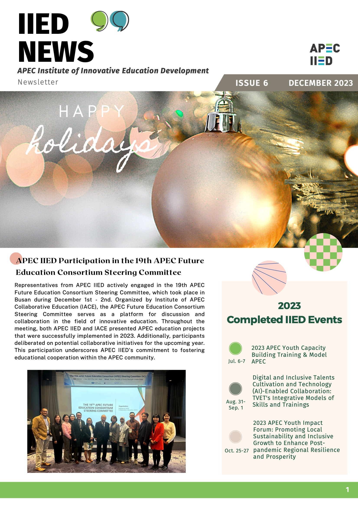

Newsletter 6

APEC IIED Participation in the 19th APEC Future Education Consortium Steering Committee

Fruitful Results from APEC Youth Capacity Building, APEC TVET Workshop, and APEC Youth Impact Forum

[button: Download](https://www.apeciied.org/_files/ugd/7c0f6d_17a6cd9652b2416ea9677992ffd24ca4.pdf)

[button: (no label)](https://www.apeciied.org/_files/ugd/7c0f6d_b2e33068d19b46d891e9f6192a450174.pdf)

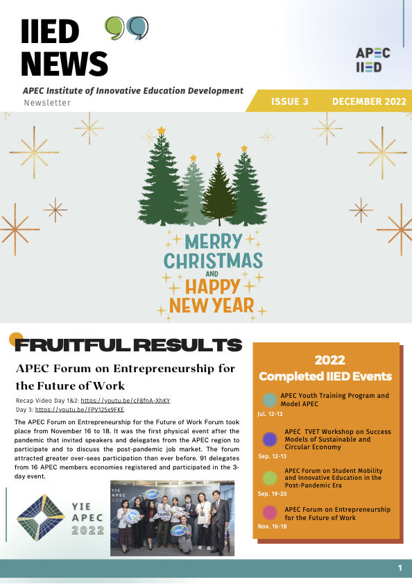

Newsletter 3

Fruitful Results: Review on APEC Forum on Entrepreneurship for the Future of Work and many more recent events!

[button: Download](https://www.apeciied.org/_files/ugd/7c0f6d_b2e33068d19b46d891e9f6192a450174.pdf)
